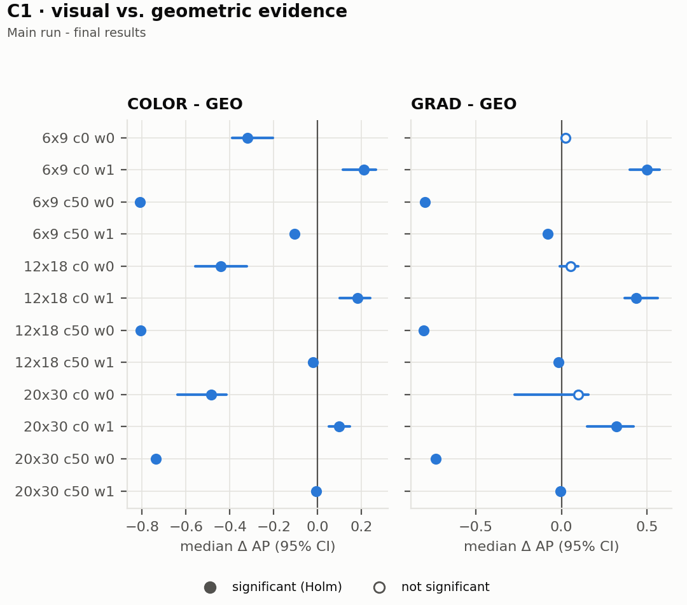
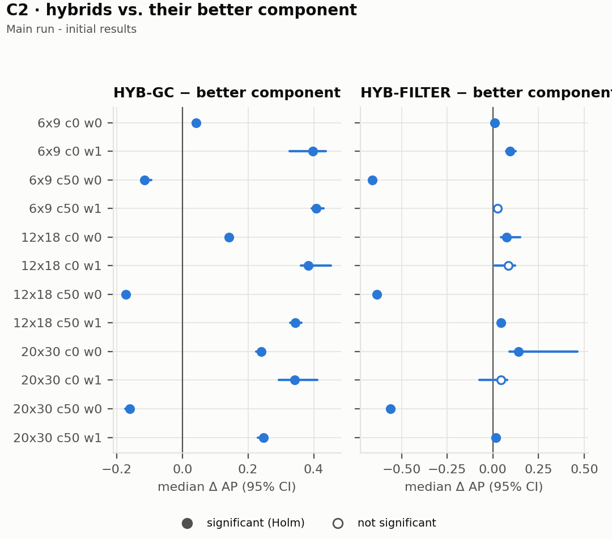
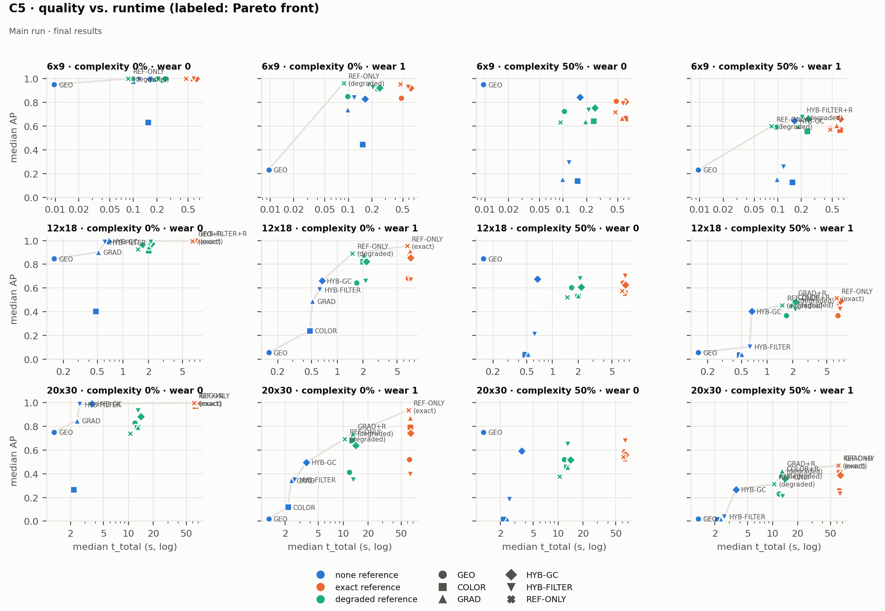
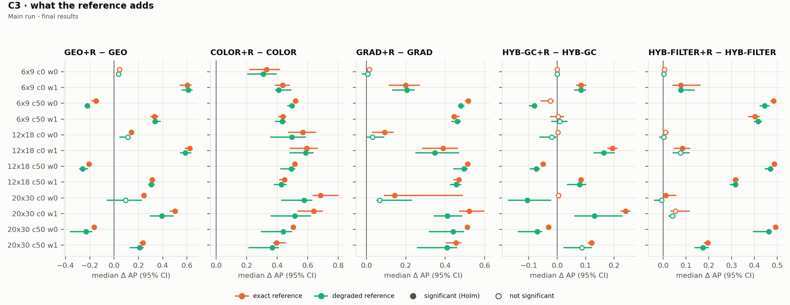

# **From Jigsaw Puzzles to General Fragment Matching: Evaluating Strategies Under Different Constraints**

## This is the subtitle of the paper, this document both explains and embodies the submission format for authors using Word

Author

Jessie Tsai, Carnegie Mellon University Masters Program, jessiet@andrew.cmu.edu

**Abstract.** Selecting a strategy for matching fragmented pieces is an engineering decision that involves matching quality, runtime, and memory, yet published results are rarely obtained under comparable conditions. This study compares geometric, color, gradient, and hybrid pairwise-matching strategies on generated jigsaw puzzles with exact ground truth, under 12 conditions that vary puzzle size, visual complexity, and boundary wear, with and without a completed reference image. No single strategy was best in every condition. Geometric matching was the strongest and cheapest choice for intact boundaries and unaffected by uniform image regions, but one pixel of boundary wear removed most of its value, while visual evidence failed in uniform regions. Hybrids improved on their better component only when both components were informative, and a reference image helped most where a method's own evidence failed but could reduce quality when fused at equal weight. Locating pieces in an exact reference dominated runtime, and no strategy exceeded 200 MiB of memory. A literature-based comparison with document and image-fragment reconstruction suggests that principles about which evidence remains informative are the most likely to transfer, whereas findings about reference images could not be assessed.

**Additional Keywords and Phrases:** pairwise matching, jigsaw puzzles, fragment reconstruction, strategy selection, performance efficiency, empirical software engineering

**ACKNOWLEDGEMENTS**

This section is used to thank mentors and colleagues or name the individuals or institutions that supported your research or provided special assistance, such as consultation or aid. Acknowledge any owners of copyrighted materials that have granted you permission to reproduce their work.

This section is optional. If the paper is long (\>50 pp) include it. If not, omit this page. Optionally, include a similar list of table and figures

# **Table of Contents**

[**1 Introduction	3**](#introduction)

[1.1 Context and Importance	3](#context-and-importance)

[1.2 Problem Statement and Claim	3](#problem-statement-and-claim)

[1.3 Research Objectives and Questions	3](#1.3-research-objectives-and-questions)

[1.4 Approach	4](#1.4-approach)

[**2 Background	4**](#background)

[2.1 Pairwise Matching and Jigsaw Puzzle Solving	4](#pairwise-matching-and-jigsaw-puzzle-solving)

[2.2 Matching Strategies and Available Information	5](#matching-strategies-and-available-information)

[2.3 Accuracy and Computational Efficiency	5](#accuracy-and-computational-efficiency)

[2.4 Puzzle Characteristics and Representativeness	6](#2.4-puzzle-characteristics-and-representativeness)

[**3 Related Works	6**](#related-works)

[3.1 Geometric, Visual, and Hybrid Matching	6](#3.1-geometric,-visual,-and-hybrid-matching)

[3.2 Computational Tradeoffs and Evaluation	7](#3.2-computational-tradeoffs-and-evaluation)

[3.3 Matching and Reconstruction Beyond Conventional Jigsaw Puzzles	7](#3.3-matching-and-reconstruction-beyond-conventional-jigsaw-puzzles)

[**4 Methods	8**](#4-methods)

[4.1 Research Design and Justification	8](#4.1-research-design-and-justification)

[4.2 Experimental Setting, Systems, and Data Sources	8](#4.2-experimental-setting,-systems,-and-data-sources)

[4.3 Experimental Conditions and Procedures	8](#4.3-experimental-conditions-and-procedures)

[4.4 Analysis Methods and Transferability Assessment	9](#4.4-analysis-methods-and-transferability-assessment)

[4.5 Threats to Validity	10](#4.5-threats-to-validity)

[**5 Results**](#5-results)

[5.1 Matching Quality Under Different Puzzle Conditions (RQ1)](#5.1-matching-quality)

[5.2 Computational Cost (RQ1)](#5.2-computational-cost)

[5.3 Effect of a Reference Image (RQ2)](#5.3-effect-of-a-reference-image)

[5.4 Transferability Assessment (RQ3)](#5.4-transferability-assessment)

[**6 Discussion**](#6-discussion)

[6.1 Interpretation of Results](#6.1-interpretation-of-results)

[6.2 Rebuttals](#6.2-rebuttals)

[6.3 Qualifiers and Threats to Validity](#6.3-qualifiers-and-threats-to-validity)

[6.4 Impacts](#6.4-impacts)

[**7 Conclusion**](#7-conclusion)

[**References	11**](#references)

[**Appendix	13**](#appendix)

1. # **Introduction** {#introduction}

   1. ## **Context and Importance** {#context-and-importance}

Matching fragmented pieces to determine which ones belong next to each other is a recurring problem in image reconstruction. In a jigsaw puzzle, a solver must identify neighboring pieces using available information, such as boundary shape, color, and texture. Related pairwise-matching problems arise in fragmented document reconstruction, torn-image reassembly, and other applications involving incomplete visual data. Although these applications differ in their fragment characteristics and reconstruction requirements, they share a fundamental challenge: determining which pairs of fragments are most likely to be adjacent.  
Different matching strategies rely on different types of evidence. Geometric strategies compare fragment boundaries, visual strategies examine image characteristics, and hybrid strategies combine multiple sources of information. Their effectiveness may depend on the available information, the visual complexity of the fragments, and the computational resources available. A strategy that achieves high matching accuracy may require more computation or memory than a simpler alternative. Consequently, selecting a matching strategy is an engineering decision involving trade-offs between effectiveness and resource consumption.  
Jigsaw puzzles provide a useful starting point for investigating these trade-offs. Their pieces can be generated under controlled conditions, and their correct adjacencies can be established as ground truth. These properties allow matching strategies to be evaluated using consistent datasets and measurements. Findings from the experiments can subsequently be compared with approaches used in other fragment-matching domains to assess whether similar strategy-selection principles may apply.

2. ## **Problem Statement and Claim** {#problem-statement-and-claim}

Existing research has explored geometric, visual, and hybrid approaches to jigsaw puzzle matching. These approaches differ in the information they use, the compatibility measures they calculate, and the computational work they require. However, selecting a suitable strategy for a particular application requires considering more than its matching accuracy. Information availability and computational requirements may also influence which strategy is appropriate under a given set of conditions.  
The problem addressed by this research is how matching strategies perform under different information and computational constraints, and how these performance differences can inform strategy selection. In particular, the study investigates whether the relative performance of geometric, visual, and hybrid strategies changes when a completed reference image is available and when puzzle characteristics vary.  
This research argues that controlled experiments on jigsaw puzzle matching can reveal how matching strategies perform under different information and computational constraints. These findings can then be compared with approaches used in other fragment-matching domains to assess whether the same strategy-selection principles may apply more broadly.  
Jigsaw puzzle matching serves as the primary experimental case study. A subsequent literature-based assessment examines similarities and differences between jigsaw matching and selected fragment-reconstruction applications. The study does not assume that results obtained from jigsaw puzzles will generalize directly to other domains; instead, it uses the comparison to identify potentially transferable principles and conditions requiring further validation.

## **1.3 Research Objectives and Questions** {#1.3-research-objectives-and-questions}

The research has two objectives. The first is to experimentally compare geometric, visual, and hybrid matching strategies under different puzzle conditions. The second is to examine how the observed performance patterns relate to approaches used in other fragment-matching domains.  
The study addresses the following research questions:

1. How do different combinations of geometric and visual features affect pairwise matching accuracy, runtime, and memory consumption under different jigsaw puzzle conditions?  
2. How does the availability of a completed reference image affect the relative performance and suitability of different matching strategies?  
3. To what extent can the observed strategy-selection principles inform pairwise-matching tasks in other fragment-reconstruction domains, and what domain-specific constraints limit their applicability?

(1) and (2) were addressed through controlled experiments. (3) was addressed through a literature-based comparison of jigsaw puzzle matching with selected applications, such as image and document reconstruction. This distinction defines the strength of the study’s conclusions: the experiments provide direct evidence for the tested jigsaw conditions, whereas broader applicability is assessed through similarities, differences, and limitations identified in existing research

## **1.4 Approach** {#1.4-approach}

The study proceeded in two phases.  
**Phase 1: Controlled jigsaw puzzle experiments.** Geometric, visual, and hybrid matching strategies were evaluated using a common experimental pipeline. The experiments distinguished between reference-free conditions, in which the matching method cannot access the completed image, and reference-image conditions, in which the completed image is available to the method. Puzzle size, visual complexity, and boundary wear were also varied. Generated puzzles with known correct adjacencies provided ground truth, and matching performance was measured alongside runtime and memory consumption.  
The evaluation focused on pairwise compatibility: estimating whether two pieces are neighbors. It did not attempt to develop or evaluate a complete puzzle-reconstruction system. A common evaluation procedure was used to improve comparability and to isolate the effects of the selected matching strategies.  
**Phase 2: Literature-based transferability assessment.** Findings from the jigsaw experiments were compared with strategies described in research on other fragment-matching applications, including image and document reconstruction. The comparison examined the types of fragments, available information, matching features, performance requirements, and computational constraints in each domain. It identified which parts of the resulting conditional guidance appear transferable and which require domain-specific adaptations or further experiments.  
Together, these phases aim to connect a controlled evaluation of a concrete matching problem with a broader engineering question: how should a system choose among alternative matching strategies when its information and resource constraints vary?

2. # **Background** {#background}

   1. ## **Pairwise Matching and Jigsaw Puzzle Solving** {#pairwise-matching-and-jigsaw-puzzle-solving}

Pairwise matching estimates whether two pieces or fragments belong next to one another. In jigsaw puzzle solving, a matching method assigns compatibility scores to candidate pairs based on evidence that their boundaries or image content are consistent with adjacency. These scores can subsequently support decisions about neighboring pieces and the assembly of larger groups.  
Pairwise matching is distinct from complete puzzle reconstruction. A complete reconstruction system must also determine global arrangement and orientation, resolve conflicts among competing local matches, and ensure consistency across the assembled puzzle. A locally compatible pair does not necessarily belong in the correct global arrangement. This study therefore evaluates only whether two pieces are adjacent, not whether a complete puzzle can be assembled. The experiment assumes that pieces are correctly oriented; global orientation recovery and full reconstruction are outside the scope. **Figure 1** shows this boundary.  
The number of potential comparisons also grows with puzzle size. For (n) pieces, evaluating every unique unordered pair requires $\frac{n(n-1)}{2}$ candidate comparisons, so total runtime grows quadratically when all pairs are scored, scaled by the cost of each comparison. Methods that compare specific sides perform several comparisons per pair, which changes the constant factor but not the quadratic growth. Memory requirements depend on how a system represents features and stores compatibility scores. A dense representation keeps a score for every candidate and also grows quadratically, whereas a filtered or sparse representation keeps only promising candidates, which reduces storage but can discard true neighbors. Feature storage instead depends on the number of pieces and the size of each representation. For example, 499,500 pair scores stored at 64 bits each occupy about 4 MB, which may be small relative to the stored features or images. Neither computation nor score storage should be assumed to be the dominant cost in every setting; both must be considered in the context of the implementation and measured experimentally.

2. ## **Matching Strategies and Available Information** {#matching-strategies-and-available-information}

Matching strategies differ in the evidence they use to estimate whether two pieces are adjacent. This study considers three broad families: geometric, visual, and hybrid matching.  
**Geometric matching** evaluates the shapes or contours of piece boundaries. A method may represent a boundary as a sequence of coordinates or a curve and calculate how closely the boundary of one piece complements that of another. For conventional jigsaw pieces, this can involve comparing opposing boundary profiles. Geometric evidence can be informative when neighboring pieces have distinctive complementary shapes. However, pieces with similar or ambiguous boundaries may be difficult to distinguish using shape alone.  
**Color-based matching** compares image colors near candidate boundaries. For example, a method can compare corresponding pixels or color distributions along boundary strips, with lower color differences indicating greater compatibility. Its effectiveness depends on whether neighboring regions have sufficiently consistent color information. Large uniform-color regions can make color evidence less discriminative because many unrelated boundaries may have similar colors.  
**Gradient-based matching** examines changes in image intensity or color across candidate boundaries. Rather than comparing color values alone, gradient-based methods evaluate whether visual transitions continue plausibly from one piece to another. This may help distinguish boundaries that have similar overall colors but different visual transitions.  
**Texture and appearance matching** compares local patterns or broader visual characteristics near candidate boundaries. These features can help distinguish regions with similar colors but different textures or structures. Their effectiveness depends on the amount of useful visual information available, the scale of the representation, and whether the relevant patterns remain visible near fragment boundaries. Texture-based matching was not tested in this study's experiments, which cover geometric, color-based, gradient-based, and hybrid matching.  
**Hybrid matching** combines geometric and visual evidence. A hybrid method may normalize and combine separate compatibility scores or use one feature to filter candidate pairs before applying another. Combining features can improve discrimination when the information sources complement each other, but it may also increase runtime, memory consumption, and implementation complexity. The benefits depend on the specific features and combination method, rather than on hybridization alone.  
These categories describe families of approaches, not interchangeable implementations. The information available to a matching method is another important constraint. In a **reference-free** setting, the completed image is unavailable to the method, which must infer adjacency from the fragments themselves. In a **reference-image** setting, the completed image is available and can provide additional visual or spatial information, depending on how the algorithm uses it.

3. ## **Accuracy and Computational Efficiency** {#accuracy-and-computational-efficiency}

Matching quality is important, but it is not the only consideration in selecting a strategy. A method that produces more accurate pairwise matches may require more computation or memory than a simpler alternative. Conversely, a computationally inexpensive method may be suitable for a system with tight resource limits even if its matching accuracy is lower.  
This study evaluates three principal dimensions:

* **Matching accuracy**: how effectively a strategy identifies true neighboring pairs and distinguishes them from incorrect candidates. Because true neighbors are a small share of candidates (Section 2.4), this study measures it with ranking-based measures rather than overall accuracy (Section 4.4).  
* **Runtime**: the time required to compute pairwise compatibility scores under the defined experimental conditions.  
* **Memory consumption**: the memory required during matching, including any substantial storage of intermediate features or pairwise scores.

These dimensions represent different aspects of system quality. ISO/IEC 25010:2023 describes performance efficiency in terms of performance relative to the resources used under stated conditions, including time behavior, resource utilization, and capacity. This provides a useful basis for treating runtime and memory consumption as explicit evaluation criteria rather than secondary observations.  
The study did not assume that one strategy is universally superior. Instead, it examined the conditions under which each strategy offers a useful balance of matching quality and computational cost. This approach can support conditional recommendations for systems with different requirements, such as prioritizing accuracy in one application while placing greater emphasis on runtime or memory limits in another.

## **2.4 Puzzle Characteristics and Representativeness** {#2.4-puzzle-characteristics-and-representativeness}

Puzzle size increases candidate comparisons much faster than true neighbors. A rectangular grid with $r{\ }$rows and $c$columns contain only $2n\ -\ r\ -\ c$ adjacent pairs. A 10 × 10 puzzle therefore has 4,950 candidate pairs and 180 true neighbors, whereas a 25 × 40 puzzle has 499,500 candidates and 1,935 true neighbors. A tenfold increase in pieces produces about a hundredfold increase in comparisons and reduces the share of true pairs from 3.6% to about 0.4%, which also makes overall accuracy less informative.  
Visual content affects how much evidence each feature can provide. In large uniform-color regions, many unrelated boundaries have nearly identical colors, so incorrect candidates can score as well as true neighbors and color-based matching loses discriminative value. Gradient and texture features depend on visible variation as well and may be similarly limited, whereas geometric evidence does not depend on image content. Similar fine textures can also be ambiguous: Yao and Shao (2003) report failures on natural scenes in which many pieces had similar, delicate textures.  
Generated puzzles are suited to controlled comparison because they provide exact ground truth and allow image content and puzzle size to vary systematically. They do not fully represent real puzzles, and their adequacy depends on the characteristic being tested. Image diversity and solid-color regions can be represented through source-image selection, but cutting geometry is more difficult. Square pieces provide no geometric evidence, while simulated interlocking cuts may be more exactly complementary than physical cuts and could overstate geometric matching. Digital cutting also preserves pixels up to the boundary, whereas physical puzzles may include irregular cuts, damaged pieces, glare, and scanning noise. Chung et al. (1998) note that camera and feature-extraction errors can give a similar but incorrect piece the best score, and Yao and Shao (2003) attribute reconstruction errors partly to scanner shadows that deform boundary curves. Rika et al. (2022) report that classical compatibility measures degrade sharply when a one-pixel frame is eroded from each piece, and Dirauf et al. (2025) report rapid declines for content-based solvers as simulated corruption increases. A reference image derived from the same digital source as the pieces may also be more exact than the reference available for a physical puzzle. Because real puzzle data were not included in this study, its results apply only to the tested generated conditions and cannot establish how strategies would rank on physical puzzles.

3. # **Related Works** {#related-works}

## **3.1 Geometric, Visual, and Hybrid Matching** {#3.1-geometric,-visual,-and-hybrid-matching}

Early research on automated jigsaw puzzles established geometric boundary matching as a way to estimate whether two pieces fit together (Freeman & Garder, 1964\). Subsequent work explored the computational complexity of puzzle solving and its relationship to other combinatorial problems, highlighting the difficulty of finding solutions for arbitrary instances (Demaine & Demaine, 2007\). These studies provide a foundation for understanding both the geometric matching problem and the need for practical matching strategies.  
Later research expanded beyond geometry alone. Chung et al. (1998) combined boundary-shape matching with color information and compared several assembly algorithms. Their results showed that adding color could substantially improve performance over shape-only matching in their tested puzzles. Yao and Shao (2003) likewise combined shape matching with image merging, demonstrating a hybrid approach in which geometric information helps propose candidate neighbors and visual information helps evaluate them. Nielsen et al. (2008) explored image features as an alternative to shape-based matching and considered a divide-and-conquer approach to reduce the number of comparisons.  
Other work has studied pairwise compatibility more directly. Jin et al. (2014) combined edge similarity with content similarity to rank candidate pieces. Guerroui and Séridi (2020) proposed a compatibility measure that combines image features and color distance. Cho et al. (2010) examined visual compatibility measures within a probabilistic reconstruction framework. Together, these studies demonstrate that feature selection and compatibility measurement can affect matching performance, and they provide precedents for evaluating geometric, visual, and hybrid approaches.  
More recent research has also investigated the relationship between matching quality and computational efficiency. Rika et al. (2022) proposed an embedding-based compatibility approach and compared its accuracy and runtime with earlier methods. Shahar et al. (2025) studied pairwise alignment and compatibility for arbitrarily irregular image fragments, using a hybrid approach and evaluating neighborhood-level precision and recall. This work is particularly relevant to the broader motivation of the present study because it moves beyond conventional puzzle-piece geometry toward fragments with more varied shapes.

## **3.2 Computational Tradeoffs and Evaluation** {#3.2-computational-tradeoffs-and-evaluation}

The total cost of a matching system depends on both the number of comparisons and the operations performed for each comparison. Feature extraction, candidate filtering, score calculation, and result storage may contribute differently across implementations.  
Prior work has addressed aspects of this problem through approaches such as reducing comparisons, using alternative visual representations, or learning compatibility scores. Nielsen et al. (2008), for example, considered divide-and-conquer techniques to reduce comparisons, while more recent compatibility approaches have examined learned representations and computational efficiency. Such work illustrates that the efficiency of a matching system cannot be inferred from its feature family alone.  
Published results also depend on the conditions under which they are obtained. Differences in image content, puzzle size, available reference information, candidate pairs, and implementation details may influence both matching quality and runtime. Consequently, results reported by separate studies do not necessarily establish which approach would perform best if the methods were evaluated on the same instances under consistent conditions.  
Empirical software engineering provides a basis for addressing this challenge through controlled procedures, explicit measurements, and validity assessment (Wohlin et al., 2012\). The aim of the present study is not to reproduce every existing solver or to claim that prior research has neglected efficiency, but to compare selected strategies under explicitly defined conditions.

## **3.3 Matching and Reconstruction Beyond Conventional Jigsaw Puzzles** {#3.3-matching-and-reconstruction-beyond-conventional-jigsaw-puzzles}

Pairwise matching also appears in applications involving fragments that differ substantially from conventional jigsaw pieces. In document reconstruction, the useful evidence depends on how the document was destroyed. For hand-ripped documents, contours remain informative: Zhu, Zhou, and Hu (2008) found candidate matches through curve matching without application-specific features, then used a relaxation process to resolve ambiguous candidates into a globally consistent result. Richter et al. (2013) combined shape- and content-based local features, using a support vector machine to identify likely corresponding contour points on fragment pairs before evaluating alignments. This resembles the filter-then-score form of hybrid matching. For mechanically shredded documents, shape tends to be less relevant and compatibility depends largely on appearance, which is difficult for binary text with little color information (Paixão et al., 2020\). Paixão et al. (2020) learned shred embeddings so that the number of neural-network inferences scales linearly with the number of shreds, reporting comparable accuracy and a roughly 22-fold speed-up over an earlier deep-learning method on 505 strip-cut shreds, although pairwise distance computation still grows quadratically.  
Fragmented-image reconstruction presents a related but distinct problem because fragments are irregular and have no predefined sides. Kamran et al. (2018) extracted fragment boundaries and formulated inter-fragment boundary matching as a longest common subsequence problem, then used multi-piece alignment to prune incorrect matches. Le and Li (2019) used a convolutional neural network to judge whether a computed alignment between two fragments was correct, then applied loop-closure constraints during global composition. Shahar et al. (2025) used fragment geometry to reduce the candidate alignments and scored the remaining alignments using image content extrapolated beyond the fragment boundaries. These approaches illustrate that the useful evidence and reconstruction constraints depend on the properties of the fragments and the intended output.  
Despite these differences, the domains share a general structure: a system evaluates candidate relationships between fragments using available evidence, then uses those relationships to support reconstruction. Methods in each domain also trade matching quality against the cost of evaluating many candidates, and several reduce that cost through filtering or reusable representations. This common structure motivates examining whether findings about feature effectiveness, information availability, and computational costs in jigsaw matching can inform strategy selection elsewhere.  
However, the similarities should not be taken as evidence of direct transferability. Document fragments may contain linguistic structure, and findings about color or boundary shape may not apply to binary text or uniformly cut strips. Irregular image fragments may have incomplete or noncomplementary boundaries, and they require a search over possible alignments that is absent when correctly oriented pieces are compared side by side. Real-world data may also contain missing content, noise, overlap, or inconsistent image quality, and some applications may impose requirements for large-scale processing or real-time operation.

# **4 Methods** {#4-methods}

## **4.1 Research Design and Justification** {#4.1-research-design-and-justification}

	This study uses a two-phase research design consisting of a controlled computational experiment and a literature-based transferability assessment. The first phase investigates how geometric, visual, and hybrid pairwise-matching strategies perform under different information and computational constraints. The second phase compares the resulting experimental findings with approaches used in other fragment-matching domains to assess whether similar strategy-selection principles may apply more broadly. This design separates empirical conclusions supported by the jigsaw experiments from broader interpretations informed by existing literature. Following established principles of empirical software engineering, the experiment used consistent inputs, defined performance measures, and documented execution conditions to support meaningful comparisons (Wohlin et al., 2012\).

## **4.2 Experimental Setting, Systems, and Data Sources** {#4.2-experimental-setting,-systems,-and-data-sources}

The experiment used software-generated jigsaw puzzles with known ground-truth adjacencies. A pilot study on three separate images was used to fix the generator, the matching methods, and the measurement procedures before the main run, and no main-set image was used for tuning.  
The source images are 23 high-resolution (HR) training images from DIV2K (Agustsson & Timofte, 2017), used for academic research only, as the dataset's license requires. The eligible filenames were sorted, and 23 were drawn with a fixed master seed (20261106): the first 3 formed the pilot set and the remaining 20 the main set. High-resolution images were required because the piece pitch is fixed at 64 px for every grid, so that puzzle size is not confounded with piece resolution. The largest grid (20 × 30) therefore needs a 1,280 × 1,920 px image, which DIV2K's downscaled sets do not provide; using those sets would also have meant a smaller pitch, which leaves fewer boundary pixels for visual measures, and bicubic downscaling smooths the edges on which color and gradient measures rely. No DIV2K image is reproduced in this paper.  
Pieces were cut with the interlocking curve code of Piecemaker (Hickenlooper, 2026), which was the only part of that software reused. Where a cut left a small disconnected island of pixels, the island was joined to the neighboring piece with which it shared the longest border, and the number of such reassignments was recorded for each instance. Ground truth comes from the generator's own cut topology, which records which pieces share each cut, and only the evaluator reads it. All 240 main-run instances (20 images under 12 conditions) were regenerated from their seeds and found to be byte-identical. No physical puzzle data were used, so the conclusions are limited to the tested generated-puzzle conditions.

## **4.3 Experimental Conditions and Procedures** {#4.3-experimental-conditions-and-procedures}

All pieces were given in their correct orientation. This scope decision isolates pairwise matching performance from the additional complexity of orientation recovery, so that differences in results can be attributed to matching evidence rather than to a method's handling of rotation. Unknown orientation would introduce another experimental variable and increase computational requirements: for four-sided pieces, the side combinations to evaluate rise fourfold, from $4n(n-1)$ to $16n(n-1){\ }$(Rika et al., 2022\). It is therefore a potential direction for future work rather than part of the current experiment.  
**Puzzle conditions.** A full factorial design produced 12 conditions: three grid sizes (6 × 9, 12 × 18, and 20 × 30 pieces, or 54 to 600 pieces), two levels of visual complexity (0% and 50%), and two levels of wear (0 and 1 px). Visual complexity was manipulated by covering one seeded, connected region of exactly the target share of pixels with the image's mean color, which creates a large uniform region of the kind described in Section 2.4; the same region was used at both wear levels. Wear simulates damage to piece boundaries by removing material only. Each piece is eroded by about 1 px along its boundary, the erosion is made irregular by Gaussian-smoothed noise (σ = pitch/10), and the largest connected part of the piece is kept. At 1 px of wear, about 10% of each piece's pixels are removed, and neighboring pieces never share image content.  
**Matching methods.** Five methods were implemented to represent the geometric, visual, and hybrid families described in Section 2.2. All five use one shared side extractor. It traces the outline of each piece at twice its resolution, locates the four corners, divides the outline into four sides, and resamples each side to 96 points. A side whose deviation from a straight line is below 5% of the piece pitch is marked flat and excluded; the pitch is derived from the sides themselves, so the methods are never given the grid size. The *geometric method* (GEO) compares the shapes of facing side profiles and never reads pixel values. The *color method* (COLOR) compares CIELAB colors sampled 1 px inside facing sides, following the form of the measure used by Cho et al. (2010). The *gradient method* (GRAD) adapts the Mahalanobis gradient compatibility of Gallagher (2012), computed in RGB, to curved sides. Because the original measure assumes straight edges, gradient statistics are computed along each curved side, Gallagher's dummy gradients are added so that the covariance can be inverted, and the scores in both directions are summed. Two hybrids represent the combination strategies described in Section 2.2. The *fusion hybrid* (HYB-GC) combines the GEO and COLOR rankings with equal weights. The *filter hybrid* (HYB-FILTER) keeps only the candidates that either side ranks among its ten best by GEO and rescores those candidates with GRAD; the share of true neighbors retained by the filter was recorded. All weights and thresholds were fixed in advance and were not tuned.  
**Reference levels.** In the reference-free level, the completed image is withheld from the method. Each method was also run with the exact completed image and with a degraded copy, which was blurred, downscaled to half resolution, JPEG-compressed, and shifted in brightness to approximate the printed image on a puzzle box. Pieces are located in the reference by masked template matching, and the resulting position evidence is combined with the method's own scores at equal rank weight; HYB-FILTER applies it only to the candidates retained by its geometric filter. Methods that use a reference are marked +R. A reference-only arm (REF-ONLY) uses the position evidence alone. Each condition therefore has 17 arms: five methods at three reference levels, plus REF-ONLY with the exact and the degraded reference.  
**Input controls.** Every run executed in a fresh process that received only a copy of the piece images, together with the reference image for arms that use it. Piece identifiers were a seeded random permutation, file names and image metadata carried no position or grid size, and a file-access guard prevented method code from reading the ground truth or, in reference-free arms, the reference. Scores were verified to be byte-identical when the ground truth and references were deleted and unchanged when piece identifiers were re-permuted.  
**Measurement.** Matching quality is deterministic, so it was measured once per arm on each of the 20 main images. To fit the available compute budget, runtime and peak memory were measured on the first 10 main images in the seeded order. For these 10 images, quality was taken from the timing runs, and the remaining 10 images received one quality run per arm (2,040 quality runs). Runtime is the total elapsed wall-clock time of a run, measured with time.perf\_counter and reported as the median of five repetitions (10,200 timing runs); CPU time was also recorded. A median was accepted as stable if it moved by less than 10% when any one repetition was left out. This rule replaced an earlier requirement that the coefficient of variation (CV) remain below 10%, because in the pilot isolated slow repetitions inflated the CV without moving the median; the CV is still reported. Reference locations are computed once per instance and reference level, and that time is added to the runtime of every arm that uses the reference. Peak memory is the Windows peak working set minus a baseline taken after loading, measured in processes separate from the timing runs (2,040 memory runs). Because the reference-location step runs in its own cached process, a reference arm's peak memory is the larger of its matching peak and its location peak; the two steps run in sequence, so the pipeline's peak is the larger of the two rather than their sum. This rule was set after the memory data had been examined, because without it the reference-only arm appeared to require almost no memory.  
All runs used one Windows 10 machine with a 12-core AMD processor and 16 GB of memory. The software was Python 3.13 with pinned package versions (including NumPy 2.2.6, SciPy 1.16.2, OpenCV 4.12.0, and scikit-image 0.25.2), and every numerical library was restricted to a single thread. The memory runs used a later code commit than the quality and timing runs, but no experiment code, configuration, or dependency changed between the two. Every run completed without failure.

## **4.4 Analysis Methods and Transferability Assessment** {#4.4-analysis-methods-and-transferability-assessment}

Matching quality is measured primarily by average precision (AP). All candidate pairs are ranked by score, and AP summarizes how highly the true neighboring pairs are ranked; tied scores are treated as a single threshold. Because true neighbors form a small share of candidates (Section 2.4), AP was preferred to overall accuracy. A random ranking obtains an AP approximately equal to the share of true pairs. Top-1 side accuracy is the secondary measure: for each side, the candidates are ranked by that side's own score, and the measure records whether the true partner is ranked first, with a tie counted as 1/(number of tied candidates). Where several side relations tie for a pair's best score, credit is divided evenly among them. The two measures answer different questions: AP reflects one global ranking of all candidates, whereas top-1 side accuracy reflects the local ranking seen from each side.  
The analysis was organized around five planned comparisons. C1 compares visual with geometric evidence (COLOR and GRAD against GEO). C2 compares each hybrid with its better component, defined as the component with the higher median in that condition. C3 compares each method with a reference against the same method without one. C4 compares the ordering of the five methods across reference levels, and C5 compares matching quality with computational cost. C1–C3 use paired per-image differences within each condition. For each comparison, the study reports the median difference, a 95% percentile bootstrap confidence interval (10,000 resamples of images), and a two-sided Wilcoxon signed-rank test, with the Holm correction applied across all 336 C1–C3 tests for both quality measures. C4 uses Kendall's τ between method orderings by median AP, and C5 identifies the arms on the Pareto front of median AP against median runtime and median peak memory. C4 and C5 are descriptive.  
In the second phase, a structured literature-based comparison examined the three fragment-reconstruction settings reviewed in Section 3.3: hand-torn documents, strip-shredded documents, and irregular image fragments. Each principal finding of the first phase was restated as a conditional principle and assessed against each setting using four ratings. A principle was rated *consistent* when a reviewed source reports a pattern that agrees with it, *plausible* when the setting resembles a tested condition but no reviewed source examines the principle directly, *limited* when a property of the setting violates an assumption on which the principle depends, and *not assessable* when the reviewed sources do not report the necessary information. The ratings are qualitative judgments rather than experimental evidence, and they are reported with their sources so that each can be checked.  
The purpose of this comparison is to assess whether similar strategy-selection principles appear relevant across domains, to identify domain-specific differences that may limit their applicability, and to determine which conclusions require further empirical validation. The second phase is not treated as experimental proof of generalization. The strategy-selection findings are therefore presented as conditional guidance grounded in the tested conditions and the supporting literature, with their limitations stated explicitly.

## **4.5 Threats to Validity** {#4.5-threats-to-validity}

The design addresses several anticipated threats. Generated puzzles provide exact ground truth but limit representativeness, so conclusions are restricted to the tested conditions. Differences between implementations are reduced by a shared side extractor, a common evaluator, identical instances for every method, and input controls that prevent methods from reading the ground truth. Runtime and memory measurements are sensitive to the execution environment, so all runs used one machine, pinned dependencies, single-threaded libraries, and separate processes for timing and memory. Several scope reductions were made to fit the available time: texture-based methods, a 25% complexity level, and 2 px wear were removed from the design. The transferability assessment depends on the coverage and quality of the selected literature. Threats observed during the experiment, and the ways in which they qualify the conclusions, are discussed in Section 6.3.

# **5 Results** {#5-results}

This section reports the results of the main run, organized by research question. Matching quality is reported over 20 images, and runtime and peak memory over the 10 timed images. All 2,040 quality runs, 10,200 timing runs, and 2,040 memory runs completed. Interpretation of the results is deferred to Section 6.

## **5.1 Matching Quality Under Different Puzzle Conditions (RQ1)** {#5.1-matching-quality}

Table 1 reports the median AP of each reference-free method in every condition, with the exact reference-only arm included for comparison. Because GEO does not read pixel values, its AP depends only on wear and puzzle size: it is 0.95, 0.85, and 0.75 on the three grids without wear, and 0.23, 0.06, and 0.02 with 1 px of wear. COLOR and GRAD show the opposite pattern. Their AP declines with wear but falls further when half of the image is uniform, to between 0.01 and 0.15.

**Table 1.** Median AP over 20 images by condition (grid; complexity c, in percent; wear w, in px).

| Condition | GEO | COLOR | GRAD | HYB-GC | HYB-FILTER | REF-ONLY (exact) |
|---|---|---|---|---|---|---|
| 6 × 9, c0, w0 | 0.951 | 0.631 | 0.981 | 0.998 | 0.993 | 1.000 |
| 6 × 9, c0, w1 | 0.232 | 0.448 | 0.740 | 0.829 | 0.839 | 0.954 |
| 6 × 9, c50, w0 | 0.951 | 0.139 | 0.154 | 0.843 | 0.294 | 0.719 |
| 6 × 9, c50, w1 | 0.232 | 0.127 | 0.153 | 0.645 | 0.259 | 0.570 |
| 12 × 18, c0, w0 | 0.848 | 0.406 | 0.902 | 0.995 | 0.986 | 0.993 |
| 12 × 18, c0, w1 | 0.058 | 0.241 | 0.489 | 0.661 | 0.585 | 0.954 |
| 12 × 18, c50, w0 | 0.848 | 0.040 | 0.043 | 0.677 | 0.212 | 0.577 |
| 12 × 18, c50, w1 | 0.058 | 0.036 | 0.042 | 0.403 | 0.105 | 0.514 |
| 20 × 30, c0, w0 | 0.751 | 0.265 | 0.847 | 0.990 | 0.984 | 0.996 |
| 20 × 30, c0, w1 | 0.021 | 0.119 | 0.343 | 0.497 | 0.349 | 0.935 |
| 20 × 30, c50, w0 | 0.751 | 0.015 | 0.016 | 0.591 | 0.185 | 0.541 |
| 20 × 30, c50, w1 | 0.021 | 0.014 | 0.015 | 0.268 | 0.038 | 0.470 |

**Visual against geometric evidence (C1).** Figure 2 shows the paired differences. Without wear or added complexity, COLOR scored significantly below GEO on all three grids (median differences of −0.32 to −0.48 AP), whereas the differences between GRAD and GEO were not significant. With 1 px of wear, both visual methods scored significantly above GEO, GRAD by +0.32 to +0.50 and COLOR by +0.10 to +0.21. At 50% complexity without wear, GEO scored significantly above both visual methods, by 0.74 to 0.81. When wear and complexity were both present, all three methods were close to their lowest values, and GEO remained significantly ahead by 0.005 to 0.10.

**Figure 2.** C1: COLOR − GEO and GRAD − GEO, difference in AP per condition. Median paired difference with 95% bootstrap confidence interval over 20 images; filled markers are significant after Holm correction.

**Hybrids against their better component (C2).** HYB-GC scored significantly above its better component in 9 of 12 conditions, by +0.04 to +0.41 AP, and significantly below GEO in the three conditions with 50% complexity and no wear, by −0.12 to −0.17 (Figure 3). HYB-FILTER scored significantly above its better component in 6 of 12 conditions and significantly below GEO in the same three conditions, by −0.56 to −0.66. Its geometric filter retained a median of at least 99.7% of true neighbors without wear, but 95%, 67%, and 41% with 1 px of wear on the 6 × 9, 12 × 18, and 20 × 30 grids.

**Figure 3.** C2: each hybrid minus its better component, difference in AP per condition. Median paired difference with 95% bootstrap confidence interval over 20 images; filled markers are significant after Holm correction. The baseline is the component with the higher median in that condition.

**Agreement between quality measures.** AP and top-1 side accuracy diverged at 50% complexity. On the 12 × 18 grid with 50% complexity and no wear, for example, COLOR had a median AP of 0.040 but a median top-1 side accuracy of 0.498, and GRAD had 0.043 and 0.522, respectively.

## **5.2 Computational Cost (RQ1)** {#5.2-computational-cost}

Table 2 reports the median runtime and peak memory of the five methods and of the reference-location step. The values are for intact cuts without added complexity; in the other conditions, runtimes differ by at most 0.1 s and memory by at most 10 MiB. GEO was the fastest method on every grid, at 0.01 s, 0.15 s, and 1.26 s. The other methods required 0.10–0.67 s on the two smaller grids and 2.17–3.63 s on the 20 × 30 grid. Peak memory grew with puzzle size; on the 20 × 30 grid, GRAD had the lowest peak among the methods (54 MiB) and HYB-GC the highest (118 MiB).  
An arm with a reference costs approximately its method plus the location step. Locating pieces in the exact reference took 61.7 s on the 20 × 30 grid, so GRAD+R with the exact reference took 64.2 s, compared with 2.4 s for GRAD alone. Locating pieces in the half-resolution degraded reference took 10.4 s. Because location and matching run one after the other, a reference arm's peak memory is the larger of the two, and with the exact reference the location step set the peak of every arm (197 MiB on the 20 × 30 grid). No arm exceeded 200 MiB.

**Table 2.** Median runtime (s) and peak memory (MiB) over the 10 timed images, for intact cuts without added complexity.

| Method or step | 6 × 9 time | 6 × 9 memory | 12 × 18 time | 12 × 18 memory | 20 × 30 time | 20 × 30 memory |
|---|---|---|---|---|---|---|
| GEO | 0.01 | 7 | 0.15 | 25 | 1.26 | 73 |
| COLOR | 0.15 | 14 | 0.48 | 41 | 2.17 | 108 |
| GRAD | 0.10 | 5 | 0.52 | 18 | 2.39 | 54 |
| HYB-GC | 0.16 | 15 | 0.67 | 43 | 3.63 | 118 |
| HYB-FILTER | 0.12 | 8 | 0.61 | 32 | 2.57 | 97 |
| Reference location, exact | 0.47 | 22 | 6.55 | 74 | 61.73 | 197 |
| Reference location, degraded | 0.09 | 6 | 1.49 | 18 | 10.41 | 44 |

**Quality against cost (C5).** GEO was on the Pareto front of AP and runtime in all 12 conditions (Figure 4); that is, no other arm was both faster and more accurate. When peak memory was added as a third criterion, GEO, GRAD, and REF-ONLY (degraded) were on the front in all 12 conditions.

**Figure 4.** C5: median AP against median runtime (log scale), one panel per condition. Median AP over 20 images; runtime over the 10 timed images; labeled points are on the Pareto front.

## **5.3 Effect of a Reference Image (RQ2)** {#5.3-effect-of-a-reference-image}

**Gain from a reference (C3).** Figure 5 shows the change in AP when each method was given a reference. The largest gains were for GEO with 1 px of wear (+0.39 to +0.62 AP without added complexity and +0.21 to +0.34 with it) and for COLOR and GRAD at 50% complexity (+0.37 to +0.52). For methods whose AP was already close to 1, such as the hybrids without wear or added complexity, the exact reference added at most 0.01. The reference also produced significant losses. GEO+R scored below GEO at 50% complexity without wear (−0.15 to −0.26), and HYB-GC+R scored below HYB-GC in several conditions, by as much as 0.11. A degraded reference usually added less than an exact one, and the gap was largest on the 20 × 30 grid. Used alone, the exact reference reached an AP of 0.93–1.00 without added complexity but only 0.47–0.72 at 50% complexity.

**Figure 5.** C3: each method with a reference minus the same method without one, difference in AP per condition. Median paired difference with 95% bootstrap confidence interval over 20 images; filled markers are significant after Holm correction. Orange indicates the exact reference and green the degraded reference.

**Method orderings (C4).** Adding an exact reference changed the order of the five methods by median AP in 11 of the 12 conditions. Kendall's τ, which equals 1 when the order is unchanged, ranged from −0.40 to 1.00 and was negative on the 20 × 30 grid with 50% complexity and 1 px of wear. The exact and degraded references produced similar orders (τ ≥ 0.6 in 10 of 12 conditions).

## **5.4 Transferability Assessment (RQ3)** {#5.4-transferability-assessment}

Table 3 reports the literature-based ratings for six principles derived from the first phase. These ratings rest on the sources reviewed in Section 3.3, not on experiments in the other domains.

**Table 3.** Ratings of each principle for three fragment-reconstruction settings.

| Principle (source comparison) | Hand-torn documents | Strip-shredded documents | Irregular image fragments |
|---|---|---|---|
| P1. Boundary shape is informative only when cut shapes vary more than the boundary damage (C1). | Consistent: torn contours remain informative (Zhu et al., 2008). | Consistent: shape carries little information and appearance dominates (Paixão et al., 2020). | Plausible: boundaries are matched (Kamran et al., 2018) but may be incomplete or noncomplementary. |
| P2. Color and gradient evidence lose discriminative value in uniform regions (C1). | Not assessable | Consistent: binary text with little color is difficult (Paixão et al., 2020). | Not assessable |
| P3. Combining evidence helps only when each source is informative (C2). | Plausible: shape and content are combined (Richter et al., 2013). | Plausible: compatibility relies largely on appearance where shape is uninformative (Paixão et al., 2020). | Plausible: geometry and content are combined (Shahar et al., 2025). |
| P4. Filter-then-score depends on both the filter and the scoring stage being informative (C2). | Plausible: candidate contour points are identified before alignments are evaluated (Richter et al., 2013). | Limited: there is little shape information with which to filter. | Plausible: geometry reduces candidate alignments before content scoring (Shahar et al., 2025). |
| P5. Reference information is most valuable where fragment evidence fails (C3). | Not assessable | Not assessable | Not assessable |
| P6. Runtime, rather than memory, becomes the binding cost as candidates increase (C5). | Not assessable | Consistent: a runtime speed-up is the reported gain, and pairwise distances still grow quadratically (Paixão et al., 2020). | Plausible: candidate alignments are reduced to limit work (Shahar et al., 2025). |

Of the 18 principle–setting pairs, 4 were rated consistent, 7 plausible, 1 limited, and 6 not assessable. The reviewed sources do not address the availability of a reference image, so P5 could not be assessed in any setting.  
Three trends from these results are carried forward to the discussion: no single type of evidence ranked first in every condition; an additional source of evidence, whether a second method or a reference, improved results mainly where the primary evidence was weak and could reduce them where it was strong; and runtime, rather than memory, separated the arms.

# **6 Discussion** {#6-discussion}

## **6.1 Interpretation of Results** {#6.1-interpretation-of-results}

The central finding is that the most suitable matching strategy depends on which evidence the puzzle conditions leave informative. Geometric matching was the strongest and cheapest choice when piece boundaries were intact, and it was unaffected by uniform image regions because it does not read pixel values. One pixel of boundary wear, however, removed most of its discriminative value, and under wear without added complexity, gradient-based matching performed best among the single methods. Visual methods, in turn, lost most of their value when half of the image was uniform. These results answer RQ1 in conditional rather than absolute terms, as anticipated in Section 2.3.  
These findings support the first part of the Claim: a controlled comparison on identical instances revealed rank reversals between strategies that a benchmark under a single condition would not show, which is the limitation of separate published results noted in Section 3.2. The Warrant for this conclusion is the design itself. Every method was evaluated on the same instances against exact ground truth, with input controls that prevent access to that ground truth, so differences in results can be attributed to the evidence each method uses rather than to differences in data. The results also extend the Backing drawn from earlier work. Section 2.4 cautioned that simulated interlocking cuts may be more exactly complementary than physical cuts and could overstate geometric matching; the strong geometric results on intact cuts, and their collapse under 1 px of wear, are consistent with that concern, and with the sharp degradation that Rika et al. (2022) report for classical measures when a one-pixel frame is eroded. The Claim is therefore modified in one respect: strategy selection is better organized around the informativeness of each source of evidence under the expected conditions than around the families of Section 2.2 themselves.  
Two outcomes were unexpected. First, hybrids did not reliably outperform their components. Equal-weight fusion improved on the better component when both components were informative, but when one component was uninformative, as color is in uniform regions, the fused ranking gave equal influence to an uninformative signal and fell below the better component alone. The filter hybrid failed in a related way: under wear on the larger grids, its geometric filter discarded many true neighbors before the gradient stage could score them, and in uniform regions the gradient stage reordered candidates that the geometric filter had already ranked well. Second, AP and top-1 side accuracy diverged at 50% complexity. Pairs inside the uniform region all receive near-perfect visual scores and crowd the top of the global ranking, so AP collapses even though each side's own ranking often still places its true partner first. A method that is useful for local decisions can therefore appear poor under a global measure, and the choice of measure should follow the intended use.  
For RQ2, a reference image was most valuable where a method's own evidence failed and added little where the method was already accurate. When its weaker signal was fused at equal weight with a strong one, as for geometric matching in uniform regions, it reduced quality. Because the reference changed the ordering of the methods, the suitability of a strategy cannot be judged without knowing whether a reference is available. The reference also carried the largest cost: locating pieces in an exact reference, rather than pairwise scoring, dominated runtime. This supports the caution in Section 2.1 that neither computation nor storage should be assumed to be the dominant cost. Memory, by contrast, did not separate the strategies in a practical sense at these puzzle sizes, so runtime should drive the choice here.  
For RQ3, the transferability assessment supports the second part of the Claim only partially. Principles concerning which evidence remains informative align most closely with the reviewed literature, particularly for strip-shredded documents, in which shape carries little information. Principles concerning the reference image could not be assessed, which indicates that RQ2's findings are the least transferable. The comparison therefore identifies plausible principles and the conditions under which they would require validation, rather than establishing that they generalize.  
**Strategy-selection guidance.** Table 4 condenses these findings into guidance for the tested conditions. It is organized by the two properties of the fragments that most affected the results, boundary condition and image content, and by whether a reference image is available. The guidance is presented as a table rather than a decision tree because the study tested only two levels of complexity and wear, so the points at which one recommendation gives way to another are not known. Each recommendation should therefore be read as applying near the tested levels rather than as a general threshold.

**Table 4.** Strategy-selection guidance for the tested conditions. AP values are medians over 20 images from Table 1 and Section 5.3; each range spans the three grid sizes (54 to 600 pieces).

| Fragment condition | No reference available | Reference available |
|---|---|---|
| Intact boundaries, varied image content | GEO when runtime matters most (AP 0.75–0.95, the fastest method); HYB-GC when quality matters most (AP 0.99–1.00, at 3 to 16 times the runtime of GEO). | Not worthwhile: the exact reference adds at most 0.01 AP to either hybrid but takes 0.5–62 s to locate. |
| Damaged boundaries (about 1 px of wear), varied image content | Avoid GEO (AP 0.02–0.23). Use HYB-GC (AP 0.50–0.83) or GRAD (AP 0.34–0.74). | Use the reference: REF-ONLY reaches AP 0.94–0.95 with the exact reference, and GRAD+R reaches 0.74–0.96 with the degraded one. |
| Intact boundaries, large uniform regions | Use GEO (AP 0.75–0.95); the visual methods (AP 0.02–0.15) and both hybrids score lower. | Keep GEO without the reference: fusing the reference with GEO lowered its AP by 0.15–0.26. |
| Damaged boundaries and large uniform regions | All methods are weak; HYB-GC scores highest (AP 0.27–0.65). | A reference helps on the larger grids: GRAD+R with the exact reference reaches AP 0.51 and 0.47, against 0.40 and 0.27 for HYB-GC. On the 6 × 9 grid, HYB-GC without a reference is comparable (0.65). |

The degraded reference produced method orders similar to those of the exact reference. On the 20 × 30 grid it was about six times faster to locate (10.4 s against 61.7 s), but it added less quality there.

## **6.2 Rebuttals** {#6.2-rebuttals}

*The results reflect particular implementations rather than strategy families.* The methods follow published compatibility measures (Cho et al., 2010; Gallagher, 2012), share one side extractor, and were evaluated on identical instances, which limits differences unrelated to the evidence used. Learned or state-of-the-art methods were not included, however, so the conclusions concern these implementations as representatives of their families. This criticism is only partly resolved.  
*The hybrid losses are an artifact of untuned equal weights.* The weights were fixed in advance to avoid tuning on main-set images. Tuned or adaptive weights could avoid the observed losses, but choosing them requires knowing which source is informative under the current conditions, which is the strategy-selection problem itself. The results therefore show the risk of combining evidence without that knowledge rather than a limit of hybridization in general.  
*The collapse of geometric matching under wear reflects the generator's limited shape variety.* This criticism is accepted. The Piecemaker curves differ from one another by only about 1 px, which is comparable to the simulated wear, and physical cuts may vary more. The finding is therefore qualified to this cut family. It remains relevant, because physical puzzles commonly include damaged or irregular boundaries (Section 2.4) and earlier work reports similar sensitivity to one-pixel erosion (Rika et al., 2022).  
*AP penalizes ties in uniform regions, so the visual methods are not as weak as AP suggests.* The secondary measure was planned for this reason and is reported. The divergence is itself a result: the appropriate measure depends on whether a system relies on a global ranking or on local decisions.  
*An exact reference is unrealistic.* A degraded reference was included for this reason. It produced similar method orderings, although its gains were smaller on the largest grid.  
*The memory rule for reference arms was chosen after the data were seen.* The rule is disclosed and mirrors the treatment of runtime. The memory conclusion does not depend on it: without the rule, the largest peak would be lower, at 118 MiB, and every arm would still remain below 200 MiB.

## **6.3 Qualifiers and Threats to Validity** {#6.3-qualifiers-and-threats-to-validity}

**Scope.** These conclusions apply to pairwise matching of correctly oriented, digitally generated jigsaw pieces with interlocking cuts from one cut family, cut from natural photographs at a 64 px pitch into puzzles of 54 to 600 pieces, with at most 1 px of simulated wear and a uniform region covering at most half of the image. They apply to hand-designed methods with fixed, untuned weights, executed single-threaded on one desktop machine. The transferability findings are literature-based judgments, not experimental results.  
**Internal validity.** Differences between methods may partly reflect implementation choices rather than the evidence used, although the shared extractor, common evaluator, and input controls reduce this risk. The hybrid results are confounded with the equal-weight fusion rule, so they describe that rule rather than every possible combination. The reference scale is estimated from total piece area and is about 5% too large at 1 px of wear, so reference gains under wear may be underestimated. The strength of the complexity manipulation varied by image: images that were already partly uniform, such as 0091 and 0217, gained less new uniform area (Appendix, Table A1), which may dilute the measured effect of complexity. The memory rule for reference arms was set after the data were seen, and the memory runs used a later code commit, although no experiment code changed.  
**External validity.** The cut family has little shape variety, so the geometric results may differ for physical puzzles or other generators. All images come from one natural-image dataset. The largest puzzle has 600 pieces; because score storage grows quadratically, memory may become a constraint at larger sizes. The transferability assessment covers three settings and the sources reviewed in Section 3.3.  
**Construct validity.** The uniform overlay is a proxy for visual complexity, erosion a proxy for physical damage, and the degraded copy a proxy for box art; each captures only part of the real phenomenon. AP and top-1 side accuracy measure different properties and disagreed under complexity, and neither measures complete reconstruction. Peak working set includes interpreter overhead, which the post-load baseline reduces but may not remove entirely.  
**Reliability.** Quality measures are deterministic, all 240 instances were regenerated byte-identically from their seeds, and dependency versions were pinned. Runtime is the median of five repetitions. Every arm passed the stability check, and the median coefficient of variation was below 1% on every grid. Two of the 240 reference-location groups, both 6 × 9 locations of about 0.1 s with a degraded reference, failed the check, which affects the corresponding runtimes by at most about 0.03 s. Twenty images limit statistical precision. In a few comparisons, such as GRAD against GEO on the 6 × 9 grid with intact cuts, the bootstrap interval excluded zero while the corrected test was not significant, because two or three images differed strongly in the opposite direction. Runtime and memory rest on 10 of the 20 images. The transferability ratings were made by a single author, so their reliability has not been checked by a second rater.

## **6.4 Impacts** {#6.4-impacts}

**Industrial impact.** For engineers who build matching or reconstruction tools, Table 4 provides a starting point for selecting a strategy: first estimate whether the expected fragments will have intact or damaged boundaries and whether their content contains large uniform regions, then check whether a reference image is available. Three practices follow beyond the table. Equal-weight fusion should be avoided when one source may be uninformative, and a candidate filter should be checked for how many true neighbors it discards under damage. The cost of locating pieces in a reference should be budgeted separately, because it can dominate runtime. At the tested sizes, runtime rather than memory should drive the decision. Evaluation tools should also report both a global and a local quality measure, because the two can lead to different conclusions.  
**Theoretical impact.** The study shows that a controlled factorial evaluation can reveal rank reversals between strategies that single-condition benchmarks conceal, which supports evaluating algorithm selection under explicitly stated conditions, as recommended in empirical software engineering (Wohlin et al., 2012). It also suggests organizing strategy-selection guidance around the informativeness of evidence under stated conditions rather than around feature families, and it treats runtime and memory as quality attributes in the sense of ISO/IEC 25010:2023.  
**Future work.** Several extensions follow directly from the qualifiers. Adaptive fusion that detects and down-weights an uninformative source could address the hybrid losses. Cut families with more shape variety, and physical puzzles, would test whether the sensitivity of geometric matching to wear generalizes. Larger puzzles would show where memory becomes a constraint. Unknown orientation, texture-based methods, and learned methods remain outside the current scope. Finally, the principles rated plausible or not assessable in Table 3 require experimental validation on shredded documents and irregular image fragments, and a replication on other hardware would test the stability of the cost results.

# **7 Conclusion** {#7-conclusion}

This study examined how geometric, visual, and hybrid pairwise-matching strategies perform under different information and computational constraints, using generated jigsaw puzzles with exact ground truth as a controlled case study. Five methods were compared on 20 images under 12 conditions that varied puzzle size, visual complexity, and boundary wear, each with no reference, an exact reference, and a degraded reference.  
For RQ1, no single strategy was best in every condition. Geometric matching was the strongest and cheapest choice for intact boundaries, reaching a median AP of 0.75 to 0.95 at the lowest runtime, and it was unaffected by uniform image regions. One pixel of wear, however, reduced its AP to 0.02 to 0.23, while color and gradient evidence fell to 0.02 to 0.15 when half of the image was uniform. Hybrids improved on their better component only when both components were informative. For RQ2, a reference image helped most where a method's own evidence failed, could reduce quality when fused at equal weight with strong evidence, and changed the order of the methods in 11 of 12 conditions. Locating pieces in an exact reference dominated runtime, at about 62 s for 600 pieces, while no arm exceeded 200 MiB of memory. For RQ3, the literature-based comparison suggests that principles about which evidence remains informative are the most likely to transfer to document and image-fragment reconstruction, whereas findings about reference images could not be assessed.  
These results support the study's Claim that controlled experiments can reveal how matching strategies perform under different constraints, and they modify it by showing that strategy selection is best guided by which evidence the conditions leave informative. The resulting guidance (Table 4) applies to the tested generated-puzzle conditions and one cut family. Validating it on physical puzzles, on cut families with more shape variety, on larger puzzles, and on fragments from other domains is the main direction for future work.

# **References** {#references}

Agustsson, E., & Timofte, R. (2017). NTIRE 2017 challenge on single image super-resolution: Dataset and study. In *Proceedings of the IEEE Conference on Computer Vision and Pattern Recognition Workshops*.

Cho, T. S., Avidan, S., & Freeman, W. T. (2010). A probabilistic image jigsaw puzzle solver. In *Proceedings of the IEEE Conference on Computer Vision and Pattern Recognition* (pp. 183–190). [https\://doi.org/10.1109/CVPR.2010.5540212](https://doi.org/10.1109/CVPR.2010.5540212)

Chung, M. G., Fleck, M. M., & Forsyth, D. A. (1998). Jigsaw puzzle solver using shape and color. In *Proceedings of the Fourth International Conference on Signal Processing* (Vol. 2, pp. 877–880). [https\://doi.org/10.1109/ICOSP.1998.770751](https://doi.org/10.1109/ICOSP.1998.770751)

Demaine, E. D., & Demaine, M. L. (2007). Jigsaw puzzles, edge matching, and polyomino packing: Connections and complexity. *Graphs and Combinatorics, 23*(Suppl. 1), 195–208. [https\://doi.org/10.1007/s00373-007-0713-4](https://doi.org/10.1007/s00373-007-0713-4)

Dirauf, R., Wolz, F., Zanca, D., & Eskofier, B. (2025). *Benchmarking content-based puzzle solvers on corrupted jigsaw puzzles* (arXiv:2507.07828). arXiv. Accepted at ICIAP 2025\. 

Freeman, H., & Garder, L. (1964). Apictorial jigsaw puzzles: The computer solution of a problem in pattern recognition. *IEEE Transactions on Electronic Computers, EC-13*(2), 118–127. [https\://doi.org/10.1109/PGEC.1964.263781](https://doi.org/10.1109/PGEC.1964.263781)

Gallagher, A. C. (2012). Jigsaw puzzles with pieces of unknown orientation. In *Proceedings of the IEEE Conference on Computer Vision and Pattern Recognition* (pp. 382–389). [https\://doi.org/10.1109/CVPR.2012.6247699](https://doi.org/10.1109/CVPR.2012.6247699)

Guerroui, N., & Séridi, H. (2020). Solving computational square jigsaw puzzles with a novel pairwise compatibility measure. *Journal of King Saud University \- Computer and Information Sciences, 32*(8), 928–939. 

Hickenlooper, J. (2026). *Piecemaker: Create jigsaw puzzle pieces from an image* (Version 0.8.1, commit 21f80208cc55caaac7f11d9a3ebbbce4aaa6d196) [Computer software]. GNU LGPL v3.0 or later. [https://github.com/jkenlooper/piecemaker](https://github.com/jkenlooper/piecemaker)

ISO/IEC. (2023). *Systems and software engineering — Systems and software Quality Requirements and Evaluation (SQuaRE) — Product quality model* (ISO/IEC 25010:2023). International Organization for Standardization.

Jin, S.-Y., Lee, S., Azis, N. A., & Choi, H.-J. (2014). Jigsaw puzzle image retrieval via pairwise compatibility measurement. In *Proceedings of the 2014 International Conference on Big Data and Smart Computing* (pp. 123–127). [https\://doi.org/10.1109/BIGCOMP.2014.6741421](https://doi.org/10.1109/BIGCOMP.2014.6741421)

Kamran, H., Zhang, K., Li, M., & Li, X. (2018). An LCS-based 2D fragmented image reassembly algorithm. In *Proceedings of the 13th International Conference on Computer Science and Education* (pp. 687–692). [https\://doi.org/10.1109/ICCSE.2018.8468808](https://doi.org/10.1109/ICCSE.2018.8468808) 

Le, C., & Li, X. (2019). JigsawNet: Shredded image reassembly using convolutional neural network and loop-based composition. *IEEE Transactions on Image Processing, 28*(8), 4000–4015. [https\://doi.org/10.1109/TIP.2019.2903298](https://doi.org/10.1109/TIP.2019.2903298)

Nielsen, T. R., Drewsen, P., & Hansen, K. (2008). Solving jigsaw puzzles using image features. *Pattern Recognition Letters, 29*(14), 1924–1933. [https\://doi.org/10.1016/j.patrec.2008.05.027](https://doi.org/10.1016/j.patrec.2008.05.027)

Paixão, T. M., Berriel, R. F., Boeres, M. C. S., Koerich, A. L., Badue, C., De Souza, A. F., & Oliveira-Santos, T. (2020). Fast(er) reconstruction of shredded text documents via self-supervised deep asymmetric metric learning. In *Proceedings of the IEEE/CVF Conference on Computer Vision and Pattern Recognition* (pp. 14343–14351).

Richter, F., Ries, C. X., Cebron, N., & Lienhart, R. (2013). Learning to reassemble shredded documents. *IEEE Transactions on Multimedia, 15*(3), 582–593. [https\://doi.org/10.1109/TMM.2012.2235415](https://doi.org/10.1109/TMM.2012.2235415)

Rika, D., Sholomon, D., David, E., & Netanyahu, N. S. (2022). *Edge2Vec: A high quality embedding for the jigsaw puzzle problem* (arXiv:2211.07771). arXiv.

Shahar, O. I., Elkin, G., & Ben-Shahar, O. (2025). *Pairwise alignment & compatibility for arbitrarily irregular image fragments* (arXiv:2507.09767). arXiv. [https\://doi.org/10.1007/978-3-032-31438-3\_11](https://doi.org/10.1007/978-3-032-31438-3_11)

Wohlin, C., Runeson, P., Höst, M., Ohlsson, M. C., Regnell, B., & Wesslén, A. (2012). *Experimentation in software engineering*. Springer. [https\://doi.org/10.1007/978-3-642-29044-2](https://doi.org/10.1007/978-3-642-29044-2)

Yao, F.-H., & Shao, G.-F. (2003). A shape and image merging technique to solve jigsaw puzzles. *Pattern Recognition Letters, 24*(12), 1819–1835. [https\://doi.org/10.1016/S0167-8655(03)00006-0](https://doi.org/10.1016/S0167-8655\(03\)00006-0)

Zhu, L., Zhou, Z., & Hu, D. (2008). Globally consistent reconstruction of ripped-up documents. *IEEE Transactions on Pattern Analysis and Machine Intelligence, 30*(1), 1–13. [https\://doi.org/10.1109/TPAMI.2007.1163](https://doi.org/10.1109/TPAMI.2007.1163)

# **Appendix** {#appendix}

|  | Input pieces             Piece A and Piece B, correctly oriented       \|       v Feature extraction   Geometric: opposing boundary profiles                                 Visual: boundary colors, gradients, or local patterns       \|       v Pairwise scoring     Compare the facing sides of A and B                                 Hybrid: combine scores, or filter with one feature first       \|       v Output                     Ranked or thresholded candidate pairs \- \- \- \- \- \- \- \- \- \- \- \- \- \- \- \- \- \- \- \- \- \- \- \- \- \- \- \- \- \- \- \- \- \- \- \- Out of scope           Global arrangement, orientation recovery, conflict resolution  |
| :---- | :---- |

**Figure 1\.** Generic pairwise-matching pipeline. The figure illustrates the strategy families; the implemented methods are described in Section 4.3 and the metrics in Section 4.4.

**Table A1.** Strength of the complexity manipulation by image: share of uniform pixels at 0% → 50% complexity, per grid. Images are listed in the seeded selection order; the first 10 are the timed images.

| Image | 6 × 9 | 12 × 18 | 20 × 30 |
|---|---|---|---|
| 0510 | 0.145 → 0.471 | 0.164 → 0.510 | 0.116 → 0.539 |
| 0186 | 0.022 → 0.472 | 0.036 → 0.506 | 0.422 → 0.773 |
| 0479 | 0.052 → 0.505 | 0.047 → 0.501 | 0.087 → 0.541 |
| 0223 | 0.045 → 0.491 | 0.143 → 0.603 | 0.204 → 0.645 |
| 0506 | 0.010 → 0.471 | 0.043 → 0.520 | 0.171 → 0.561 |
| 0173 | 0.037 → 0.488 | 0.099 → 0.538 | 0.137 → 0.525 |
| 0730 | 0.007 → 0.466 | 0.014 → 0.487 | 0.065 → 0.509 |
| 0178 | 0.066 → 0.458 | 0.059 → 0.501 | 0.101 → 0.538 |
| 0091 | 0.602 → 0.693 | 0.604 → 0.726 | 0.537 → 0.769 |
| 0525 | 0.064 → 0.497 | 0.234 → 0.591 | 0.268 → 0.589 |
| 0407 | 0.176 → 0.514 | 0.107 → 0.537 | 0.141 → 0.549 |
| 0016 | 0.002 → 0.475 | 0.015 → 0.487 | 0.072 → 0.523 |
| 0473 | 0.192 → 0.539 | 0.218 → 0.590 | 0.187 → 0.587 |
| 0288 | 0.005 → 0.470 | 0.008 → 0.486 | 0.016 → 0.499 |
| 0354 | 0.038 → 0.450 | 0.055 → 0.496 | 0.073 → 0.516 |
| 0737 | 0.117 → 0.538 | 0.310 → 0.678 | 0.455 → 0.757 |
| 0587 | 0.303 → 0.617 | 0.352 → 0.715 | 0.496 → 0.760 |
| 0217 | 0.501 → 0.699 | 0.683 → 0.826 | 0.810 → 0.887 |
| 0633 | 0.133 → 0.523 | 0.265 → 0.681 | 0.562 → 0.851 |
| 0459 | 0.309 → 0.572 | 0.220 → 0.565 | 0.300 → 0.647 |
